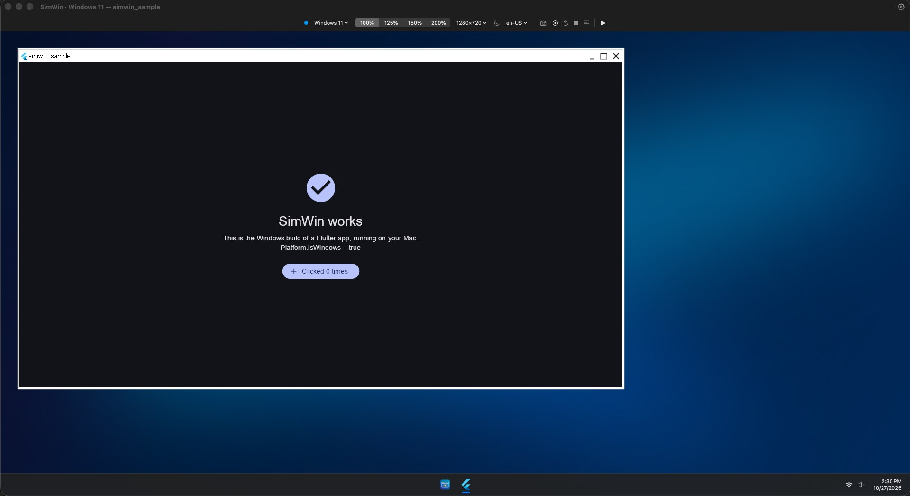

<p align="center">
  <a href="https://simwin.dev"></a>
</p>

<h1 align="center">SimWin</h1>

<p align="center">
  <strong>Test your Flutter Windows app, right on your Mac.</strong><br>
  <strong>Beta 0.0.2</strong> · Debug builds · Hot reload · DevTools
</p>

<p align="center">
  <a href="https://simwin.dev/download/SimWin.dmg"><strong>Download for macOS</strong></a> ·
  <a href="https://simwin.dev/install/">Install guide</a> ·
  <a href="https://simwin.dev">simwin.dev</a> ·
  <a href="https://github.com/ShreeBhagwat/simwin-releases/releases">Release notes</a>
</p>

<p align="center">
  
  <br><sub>A real Windows build, running on a Mac. <code>Platform.isWindows</code> is true.</sub>
</p>

SimWin compiles your Flutter app into a **real Windows `.exe`** on your Mac and runs it in a Windows 11-style simulator.
Pick **SimWin · Windows 11** in VS Code or Android Studio and press Run. No PC, no virtual machine.

> [!NOTE]
> **SimWin is in beta (version 0.0.2) and makes debug builds only.** It works for everyday debugging with hot reload,
> breakpoints and DevTools, but expect rough edges. Release and profile builds aren't supported yet.
> Please [report anything that goes wrong](#found-a-problem).

## A real Windows app, not a look-alike

SimWin isn't a Mac app made to look like Windows. It cross-compiles your Flutter project into a genuine Windows executable
and runs that exact file, so you test the code your Windows users get.

```console
$ ls out/
simwin_sample.exe  flutter_windows.dll  data/

$ file out/simwin_sample.exe
simwin_sample.exe: PE32+ executable (GUI) x86-64, for MS Windows
```

- **Compiled for Windows.** clang targeting Windows x64 (llvm-mingw), CMake and Ninja compile your runner and plugins into a 64-bit Windows executable.
- **Flutter's Windows engine.** Your Dart code runs on `flutter_windows.dll`, the same engine `flutter build windows` uses, not Flutter's macOS engine.
- **Windows code paths run.** `Platform.isWindows` is true, paths are `C:\…`, and your plugins' Win32 C++ code is compiled and called.
- **Not a VM, not a look-alike.** Wine runs the `.exe` by translating its Windows API calls to macOS. There is no copy of Windows and no Mac version of your app.

## Install

```sh
curl -fsSL https://simwin.dev/install.sh | bash
```

This downloads, verifies and installs SimWin, adds the `simwin` command, and runs setup.
Or [download the DMG](https://simwin.dev/download/SimWin.dmg), drag SimWin to Applications and open it.
Setup downloads the build tools (about 400 MB) and checks everything with a sample app. It takes about five minutes, once.

| | Requirements |
|---|---|
| macOS | 14 Sonoma or later |
| Processor | Apple Silicon (with Rosetta 2, which setup installs) or Intel |
| Flutter | Stable channel, 3.45 – 3.47 |
| IDE | VS Code with the Flutter extension, Android Studio or IntelliJ, or just Terminal |
| Storage | About 3 GB after setup, plus build caches |

SimWin is signed with Developer ID, notarized by Apple, and keeps itself up to date.

## What SimWin does

- **The real Windows build.** Compiled for Windows x64 on your Mac. `Platform.isWindows` is true, paths are `C:\…`, and your Windows plugin code runs.
- **A device in your IDE.** "SimWin · Windows 11" shows up in VS Code, Android Studio and `flutter devices`, just like an emulator.
- **Hot reload and DevTools.** Debug mode with hot reload, hot restart, breakpoints and Flutter DevTools, as on a Windows PC.
- **A Windows-style desktop.** Your app runs on a desktop with a taskbar, a Start menu and a real Windows title bar: minimise, maximise and close behave as on Windows. Apps you've run appear as desktop icons.
- **Wi-Fi switch.** Turn Wi-Fi off from the taskbar (or `simwin network off`) to test offline handling. Your debugger stays connected.
- **Simulator toolbar.** Display scale from 100 to 200 %, window size, light or dark mode, and locale, including right-to-left.
- **Screenshots and recordings.** Capture the app window as PNG or video, from the toolbar, the menu bar or the command line.
- **Profiles.** Save combinations of scale, size, theme and locale, then switch between them in one click.
- **Plugins that compile.** Windows plugin code is built with clang. Plugins that need Visual Studio-only tools are named, not left to fail silently.
- **Command line.** `simwin open`, `simwin screenshot` and `simwin doctor` work in Terminal and scripts, no IDE needed.
- **Your project stays untouched.** SimWin builds from a private copy. It never edits your files, pubspec or Git state.

## How it works

1. **Install and set up** SimWin (above).
2. **Pick the device.** Open your Flutter project in VS Code or Android Studio and choose **SimWin · Windows 11**.
3. **Press Run.** SimWin builds the Windows app and opens it in the simulator. Edit your code and hot reload as usual.

What happens when you press Run:

| Step | |
|---|---|
| Your project | Copied to a private staging folder. The original is never changed. |
| Compiled for Windows x64 | clang (llvm-mingw), CMake and Ninja, with Flutter's Windows engine. |
| `my_app.exe` | The same debug build a Windows PC would produce. |
| Runs on your Mac | Through Wine, a compatibility layer, not a VM. Graphics go DXVK → MoltenVK → Metal. |
| Connected to your IDE | Over the Dart VM service: hot reload, breakpoints, DevTools. |

The first build of a project takes a few minutes, while SimWin fetches Flutter's Windows engine files and compiles everything.
After that, builds are incremental and hot reload takes well under a second.

## Command line

```sh
simwin open path/to/project              # build and run without an IDE
simwin stop                              # stop the running app
simwin screenshot --output shot.png      # save the app window as PNG
simwin profile list | use | create | set # scale, size, theme and locale
simwin network on | off                  # the simulator's Wi-Fi
simwin doctor                            # check everything, with a fix for each problem
simwin report                            # create a problem report to send to us
```

Run `simwin help <command>` for the options.

## Good to know

> [!CAUTION]
> **Still do a final check on Windows.** This is your real Windows build running under a compatibility layer, not Windows itself. Fonts, system dialogs (file pickers, printing) and some Win32 APIs can differ.

- **Beta, debug builds only.** Release and profile builds need Windows-only tools, so build the `.exe` you ship on Windows or in CI.
- **Visual Studio-only plugins aren't supported yet.** Plugins that need C++/WinRT, MFC, ATL, NuGet or WebView2 are left out of the build, and SimWin names them.
- **Rosetta 2 on Apple Silicon.** Windows x64 code runs through Rosetta: fine for UI work and debugging, not for benchmarking.

## Found a problem?

In SimWin, choose **Help ▸ Report a Problem…** (or run `simwin report`). It writes an email to us with the details we need attached, or opens a GitHub issue.
You can also [open an issue](https://github.com/ShreeBhagwat/simwin-releases/issues/new) or email support@codeaamy.com. Plugins that don't build are especially useful to hear about.

## This repository

It holds SimWin's release files; SimWin's source is not here.

- `download/`: the newest DMG, its SHA-256 and the update feed, served as `https://simwin.dev/download/SimWin.dmg` and `https://simwin.dev/download/appcast.xml`.
- [Releases](https://github.com/ShreeBhagwat/simwin-releases/releases): every version, with release notes.
- [`licenses/`](licenses): third-party notices and the Wine source offer.

---

SimWin is made by Codeaamy Private Limited. It is not affiliated with, or endorsed by, Microsoft, Google or the Wine project.
Windows is a trademark of Microsoft Corporation. Flutter is a trademark of Google LLC. Mac and macOS are trademarks of Apple Inc.
